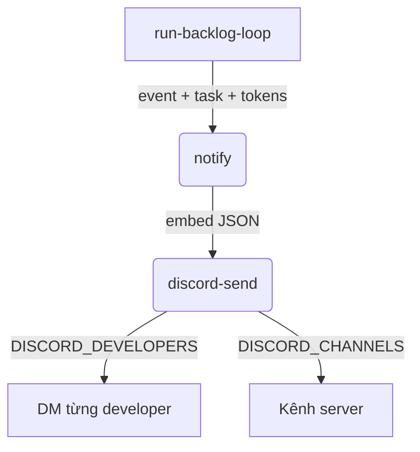

# Discord Notification Cho Backlog Automation Loop

Loop chạy task (`run-backlog-loop`) bắn một thông báo Discord sau mỗi task xong, mỗi lần bị chặn / tự
phục hồi (self-heal) và khi dừng. Thông báo gửi được tới **DM của developer**, tới **kênh server**, hoặc
**cả hai**. Mỗi đích có danh sách ID riêng trong `.env`: không có ID nào thì đích đó không nhận gì, hai
danh sách đều trống thì không gửi gì cả.

---

## 1. Kiến trúc

| File | Vai trò |
|------|---------|
| `.env` (root repo, gitignored) | Bot token + danh sách ID đích |
| `.claude/scripts/run-backlog-loop.sh` / `run-backlog-loop-core.ps1` | Bắt sự kiện của loop, gọi `notify` kèm task, token, thời gian |
| `.claude/scripts/notify.sh` / `notify.ps1` | Chọn tiêu đề + màu theo `--event`, thêm tên project (đọc từ profile), dựng embed |
| `.claude/scripts/discord-send.sh` / `discord-send.ps1` | Đọc `.env`, gửi embed tới từng DM và từng kênh |



`notify.ps1` tự gửi luôn (khối sender của nó giống hệt `discord-send.ps1`, có test chặn lệch), nên trên
Windows nó không phụ thuộc file kia. Loop **không bao giờ** dừng vì thông báo lỗi: mọi lỗi mạng / quyền
chỉ in log, script luôn exit 0.

---

## 2. Cấu hình

### Bước 1 — Tạo bot, lấy token
1. Vào [Discord Developer Portal](https://discord.com/developers/applications) → **New Application** →
   đặt tên (vd `<tên project> Backlog Agent`).
2. Mục **Bot** → **Reset Token** → copy (đây là `DISCORD_BOT_TOKEN`).
3. Mục **OAuth2 → URL Generator**: scope `bot`, quyền **View Channels**, **Send Messages**, **Embed Links**
   → mở link sinh ra để mời bot vào server.

### Bước 2 — Lấy ID
Bật Developer Mode trong Discord (**User Settings → Advanced → Developer Mode**), rồi:
- **DM:** chuột phải avatar người nhận → **Copy User ID**. Bot phải chung ít nhất một server với người đó,
  và người đó không chặn DM từ thành viên server.
- **Kênh:** chuột phải tên kênh → **Copy Channel ID**. Bot phải là thành viên server đó và có quyền
  View Channel + Send Messages + Embed Links **ở kênh đó** (kênh private: thêm bot/role của bot vào kênh).

### Bước 3 — `.env` ở root repo (cùng cấp `Assets/`)

```env
# Discord Bot Notification Settings
DISCORD_BOT_TOKEN=YOUR_DISCORD_BOT_TOKEN_HERE
# DM từng developer (tuỳ chọn) — để trống = không gửi DM
DISCORD_DEVELOPERS=DEVELOPER_USER_ID_1,DEVELOPER_USER_ID_2
# Post vào kênh (tuỳ chọn) — để trống = không post kênh
DISCORD_CHANNELS=
```

- Nhiều ID: phân cách bằng dấu phẩy (dấu cách / `;` cũng được). ID trùng chỉ gửi một lần.
- ID chỉ gồm chữ số; giá trị khác (placeholder, gõ nhầm) bị bỏ qua kèm cảnh báo — `.env` điền dở không
  bao giờ gửi bậy.
- Chấp nhận `export KEY=…`, giá trị trong `"…"` / `'…'`, comment cuối dòng ` # …`, file CRLF / có BOM.
- Key có trong `.env` thắng biến môi trường của shell; key **trống** trong `.env` tắt đích đó.

### Bước 4 — Không commit `.env`
`.gitignore` của project phải có dòng `.env`.

### Tên project trên tiêu đề (tuỳ chọn)
Tiêu đề bắt đầu bằng tên project: `displayName` trong `.claude/project-profile.json`; để trống thì lấy
`projectName` tách theo CamelCase (`MyGame` → `My Game`).

---

## 3. Nội dung thông báo

Embed gọn để đọc trên điện thoại — không dùng field, mỗi chủ đề một dòng:

```
My Game: ✅ Task Completed (Task 5/12, 00:04:12)        ← project: sự kiện (vị trí, thời lượng)
**Tên task** · `042-fix-thing.md`                       ← tên file task (link nếu là http/https)
Committed `abc1234` to `main`, pushed - next: …          ← commit + trạng thái push thật
**Tokens** 12.3M tok · in 1.2K · out 45K · …
**By model** opus 10M ~$5.10 · haiku 2.3M ~$0.40
**Loop total** 3 iters · 41.2M tok · ~$28.90
**Per tool** (time/tokens, approx.) exec 12.3m/1.2M · Read 3.1m/400K
```

- Sự kiện lỗi/dừng: chi tiết lỗi nằm trong code block. Ký tự markdown trong tên task được escape.
- Thông báo không ping ai (`allowed_mentions` rỗng), kể cả khi log có `@everyone`.
- Danh sách sự kiện + màu/biểu tượng: khối `case` trong `notify.sh` (twin `switch` trong `notify.ps1`) —
  `TASK_COMPLETED`, `BACKLOG_EMPTY`, các `*_BLOCKED`, `TASK_RECOVERING`, `TASK_PARKED`, `PARKED_ONLY`,
  `LIMIT_WAIT`, `BUSY_WAIT`, `EDITOR_RECOVERY`, `API_RETRY`, `SILENT_RETRY`, `TASK_CHECKPOINTED`,
  `CHECKPOINT_LIMIT`, `GATE_RECEIPT_MISSING`, `AUDIT_DONE`, `MANUAL_INTERVENTION`, `CLI_ERROR`…

---

## 4. Kiểm thử

```bash
# Xem embed sẽ gửi (không gửi gì)
NOTIFY_DRY_RUN=1 bash .claude/scripts/notify.sh --event TASK_COMPLETED --task "Thử" --progress 1/3

# Gửi thật tới mọi đích đang cấu hình (đọc log để biết đích nào lỗi)
bash .claude/scripts/notify.sh --event BACKLOG_EMPTY --task "N/A" --details "Test thông báo."
bash .claude/scripts/discord-send.sh "Test thông báo"
```
```powershell
powershell -ExecutionPolicy Bypass -File .claude/scripts/notify.ps1 -Event BACKLOG_EMPTY -Details "Test thông báo."
```

Unit test: `python3 -m unittest discover -s .claude/scripts/tests -p "test_discord_notify.py"` (đặt
`PWSH=<đường dẫn pwsh>` để chạy cả phần PowerShell).

### Lỗi thường gặp

| Log | Nguyên nhân |
|-----|-------------|
| `DISCORD_BOT_TOKEN not configured` | Thiếu token / còn placeholder |
| `Neither DISCORD_DEVELOPERS nor DISCORD_CHANNELS holds a valid ID` | Chưa điền ID nào hợp lệ (cố ý tắt thông báo cũng ra dòng này) |
| HTTP 401 | Token sai hoặc đã bị reset |
| HTTP 403 `50001 Missing Access` / `50013 Missing Permissions` | Bot không thấy kênh hoặc thiếu Send Messages / Embed Links ở kênh đó |
| HTTP 403 `50007 Cannot send messages to this user` | Không chung server với bot, hoặc người nhận tắt DM |
| HTTP 404 `10003 Unknown Channel` | Channel ID sai, hoặc đang dùng User ID ở `DISCORD_CHANNELS` |
| HTTP 000 | Không có mạng / Discord không phản hồi trong 30 giây |
